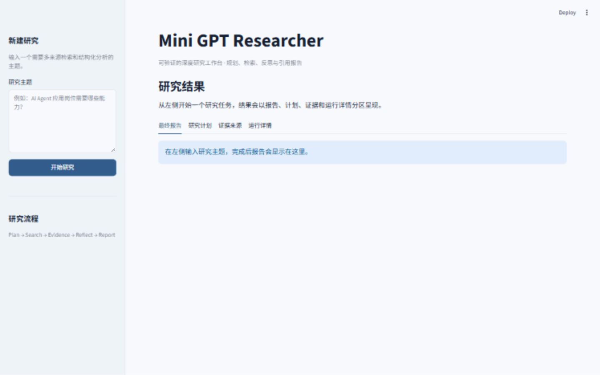
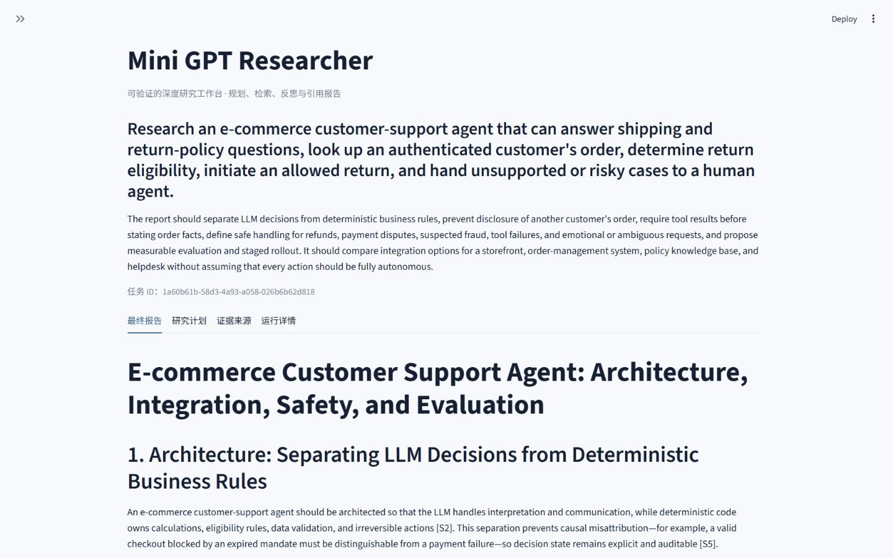
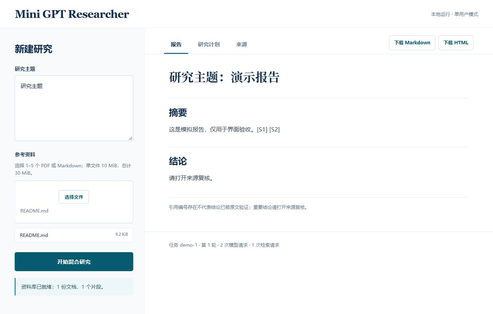
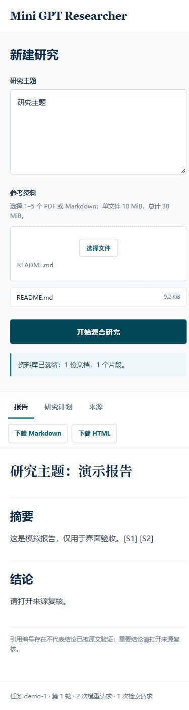

# Mini GPT Researcher

一个面向学习与作品集展示的深度研究 Agent。用户输入研究主题后，系统会规划问题，从公开网页、私有 PDF/Markdown 或两者同时检索，整理证据、判断信息缺口，并生成带来源编号的 Markdown 与 HTML 报告。

本项目参考 [GPT Researcher](https://github.com/assafelovic/gpt-researcher) 的公开产品思路，从零重写了一个范围更小、便于解释和测试的版本。它不是 GPT Researcher 的完整复刻，也不声称具备生产级可靠性。

## 它解决什么问题

普通聊天模型可以直接回答问题，但答案可能没有经过搜索，也不容易追溯来源。本项目把一次研究拆成可检查的流水线：

```text
研究主题
  -> Planner：生成结构化研究计划
  -> TavilySearch / ChromaDocumentRetriever：按模式检索网页、私有文档或两者
  -> EvidenceManager：去重并编号为 S1、S2……
  -> Reflector：判断证据是否充足，必要时生成补充问题
  -> ReportWriter：生成报告并校验引用编号
  -> ResearchRepository：把任务、证据和报告保存到 SQLite
  -> FastAPI / Streamlit：提供接口和演示页面
```

LLM 负责规划、反思和写作；Python 代码负责流程顺序、搜索上限、状态、引用校验、失败处理和持久化。

想先用中文理解项目、准备作品集介绍，或沿一次真实请求读代码，可看 [中文项目导读与学习路线](docs/2026-10-21-rag-project-guide.md)。这里的 RAG 指“检索增强生成”：先从上传文档中检索相关片段，再把片段作为证据交给模型写报告；它不是模型训练或微调。

## 当前能力

- DeepSeek 结构化输出：研究计划、证据反思、最终报告
- Tavily 联网搜索，并用统一 `SearchResult` 格式隔离外部 SDK
- 私有 PDF/Markdown 入库：LangChain Loader 与文本切分、千问 Embedding API、本地 Chroma 索引
- `web` / `document` / `hybrid` 三种模式；旧请求默认 `web`
- 最多两轮研究：首轮搜索 + 必要时的补充搜索
- Evidence 去重、连续编号、最多保留 12 条
- 报告引用只允许使用真实 Evidence 编号
- SQLite 保存任务的最新状态、证据和报告
- 旧版 SQLite 网页任务可事务性迁移为新版结构，保留原有记录
- FastAPI：创建、列表、查询任务和读取报告
- Streamlit：输入主题、查看计划/证据/报告/用量、下载 Markdown/HTML
- React + TypeScript + Vite 独立前端：上传资料、发起混合研究、查看报告/计划/来源并下载结果（本地单用户 MVP）
- FakeLLM 与 FakeSearch 离线测试，不消耗真实 API
- Fake Embedding / Retriever 测试以及真实本地 Chroma 重开检索测试

## 界面预览

### 研究工作台



### 研究结果



以上截图为原纯联网界面；新增上传与三模式选择后的截图仍待更新。

### 独立前端 V1（模拟接口演示）





这两张图只证明页面和交互呈现；截图数据来自本地模拟接口，并非真实研究结果。产品需求和交互映射见 [PRD](docs/2026-10-24-product-frontend-prd.md) 与 [交互图](docs/2026-10-24-product-frontend-interaction-map.md)。

## 项目结构

```text
src/mini_researcher/
  api.py           # FastAPI 入口与真实依赖组装
  service.py       # 单次研究任务的应用服务
  orchestrator.py  # plan -> search -> reflect -> search 的流程调度
  planner.py       # 生成 ResearchPlan
  search.py        # Tavily/Fake 搜索边界
  embedding.py     # 千问 Embedding 适配器
  knowledge.py     # PDF/Markdown 入库、切分与就绪清单
  retrieval.py     # Chroma 文档检索边界
  evidence.py      # 网页/文档结果去重、编号与容量限制
  reflector.py     # 判断证据缺口并产生补充问题
  report.py        # 报告生成、引用校验与 HTML 转换
  repository.py    # SQLite 持久化
  ui.py            # Streamlit 页面
tests/             # 离线单元、集成、API 与 UI 冒烟测试
frontend/          # React + TypeScript + Vite 独立客户端
docs/              # 设计、学习笔记和固定案例评估
```

## 本地运行

要求 Python 3.11+。以下命令在 PowerShell 中执行。

```powershell
python -m venv .venv
.venv\Scripts\python.exe -m pip install -e ".[dev]"
```

复制 `.env.example` 为本地 `.env`，只在本机填写密钥，不要提交 `.env`：

```dotenv
DEEPSEEK_API_KEY=你的密钥
TAVILY_API_KEY=你的密钥
DASHSCOPE_API_KEY=你的千问 Embedding 密钥
```

启动 API：

```powershell
.venv\Scripts\python.exe -m uvicorn mini_researcher.api:app --reload
```

浏览器打开 `http://127.0.0.1:8000/docs` 查看接口文档。主要接口：

| 方法 | 路径 | 作用 |
| --- | --- | --- |
| POST | `/research` | 执行一次研究并返回完整状态 |
| POST | `/knowledge-bases` | 上传 PDF/Markdown，返回 `knowledge_base_id` |
| GET | `/research` | 列出已保存任务 |
| GET | `/research/{task_id}` | 查询一个任务 |
| GET | `/research/{task_id}/report` | 获取最终报告 |

`POST /research` 可使用 `{"topic":"研究主题","retrieval_mode":"hybrid","knowledge_base_id":"上传返回的ID"}`。省略后两个字段时仍执行旧版联网研究。`document`、`hybrid` 模式必须提供已就绪的知识库 ID；网页模式不需要千问密钥。单次上传最多 5 个文件、单文件 10 MiB、总计 30 MiB，仅支持可提取文字的 PDF 和 Markdown。扫描版 PDF 不包含 OCR。

上传文档与 Chroma 索引保存在被 Git 忽略的 `data/knowledge_bases/`，不会提交到仓库。不要上传敏感或未获授权的材料；当前版本没有用户登录与隔离，适合本地单用户演示。

启动 UI（API 需保持运行）：

```powershell
.venv\Scripts\python.exe -m streamlit run src/mini_researcher/ui.py
```

### 启动独立网页前端

先按上文启动 FastAPI，再在另一个 PowerShell 窗口执行：

```powershell
cd frontend
npm install
npm run dev
```

打开 `http://127.0.0.1:5173/`。Vite 将浏览器请求的 `/api/*` 代理到本机 `127.0.0.1:8000`；密钥仍只由 Python 后端读取。新页面目前只开放混合检索，因此需要 PDF/Markdown 和非空主题；旧 Streamlit 仍可使用三种检索模式。`POST /research` 同步执行，页面只显示“正在研究”，不展示虚构的阶段进度。上传的文档写入后端本地目录，新页面没有账号隔离，仅适合本机单用户使用。

前端检查：

```powershell
cd frontend
npm test -- --run
npm run build
npm run lint
```

## Docker

```powershell
docker build -t mini-gpt-researcher:local .
docker run --rm -p 8000:8000 --env-file .env -v "${PWD}/data:/app/data" mini-gpt-researcher:local
```

容器默认运行 FastAPI 的 `8000` 端口，并以非 root 用户运行。挂载 `data/` 是为了保留 SQLite 与 Chroma 文件。旧版镜像曾完成本地构建与接口验证；加入 RAG 依赖后的镜像尚未重新验证，不能把旧结果视为新版验收。真实混合研究还需要 DeepSeek、Tavily 和千问 Embedding 密钥。

## 测试与评估

离线测试：

```powershell
.venv\Scripts\python.exe -m pytest -q
```

自动化测试覆盖数据模型、Agent 流程、旧库迁移、入库、检索、错误路径、API 和 UI。2026-10-20 本机完整测试连续两次运行均为 `106 passed`，依赖检查无冲突。已通过本地 Markdown → Chroma 持久化 → 重新打开检索（Fake Embedding，无外部 API），以及可提取文字 PDF 的页码测试。

2026-10-20 另用非敏感示例 Markdown 完成真实千问 Embedding 入库与 Chroma 重开检索；受控混合研究完成 2 轮、3 次 LLM 请求、6 次联网搜索，获得 11 条网页 Evidence 和 1 条文档 Evidence，报告生成且 SQLite 读回状态一致，无运行错误。该测试使用临时目录，没有迁移现有 `data/research.db`。单次成功和引用编号合法不等于语义事实核查或生产稳定性。新版 Docker 镜像仍待重新验收。

真实 DeepSeek + Tavily 端到端测试已覆盖任务规划、两轮搜索、Evidence 整理、报告生成、SQLite 持久化和引用编号校验。

固定评估案例位于 `tests/fixtures/research_cases/`，评分规则见 `docs/evaluation-rubric.md`，真实结果见 `docs/evaluation-results-v1.md`。企业文档 Agent、电商客服 Agent 和浏览器自动化 Agent 三个案例均已完成真实 DeepSeek/Tavily 运行。

## 已知限制

- `POST /research` 当前同步执行，长任务可能需要等待。
- 搜索与报告质量依赖公开来源，重要结论仍需人工复核。
- 当前版本不包含多用户权限、知识库访问隔离、OCR 和生产级任务队列。
- 引用编号合法只证明该来源存在，不证明报告结论已被来源语义支持；重要结论需人工复核。
